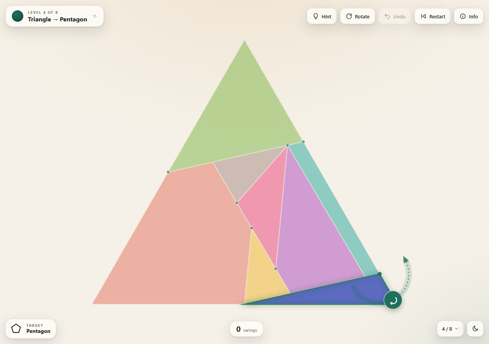
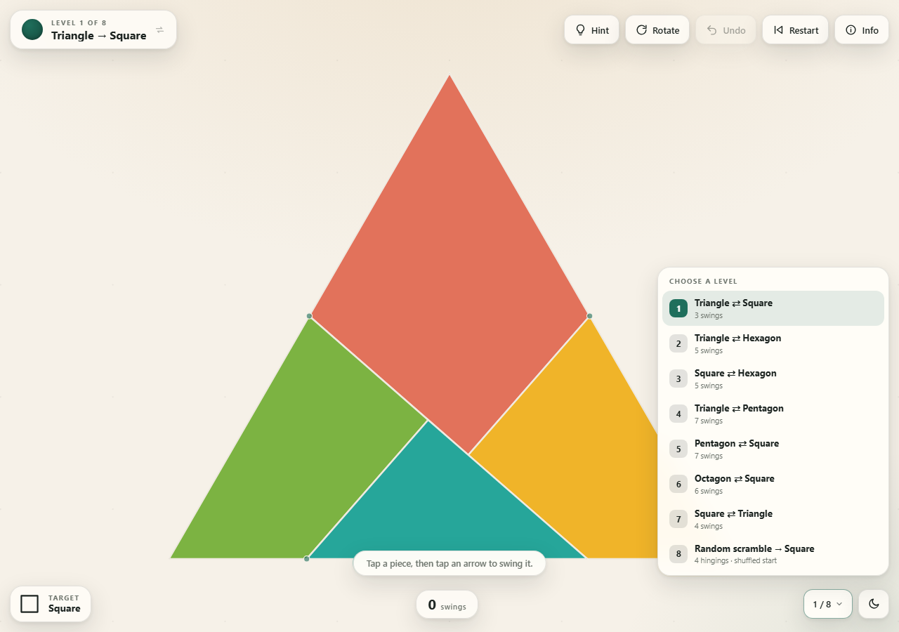
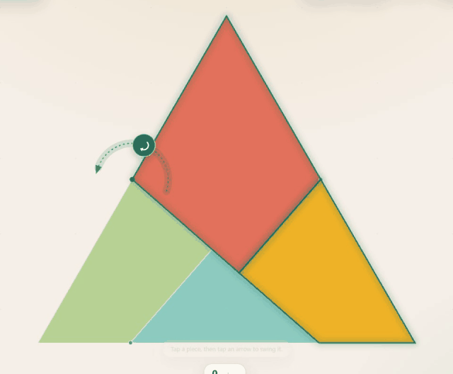
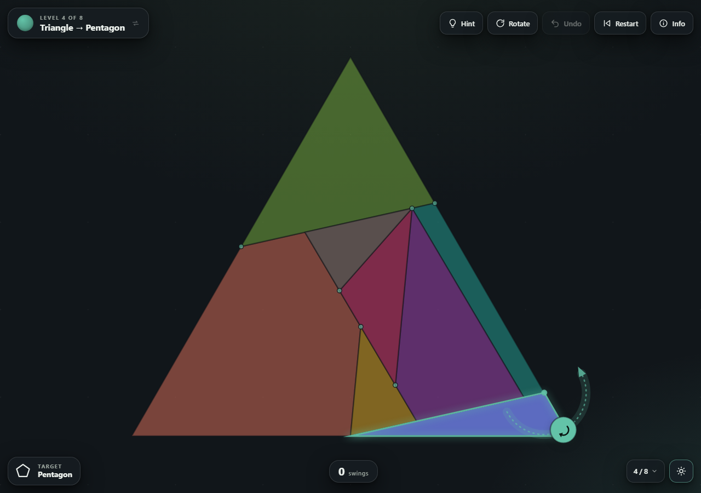
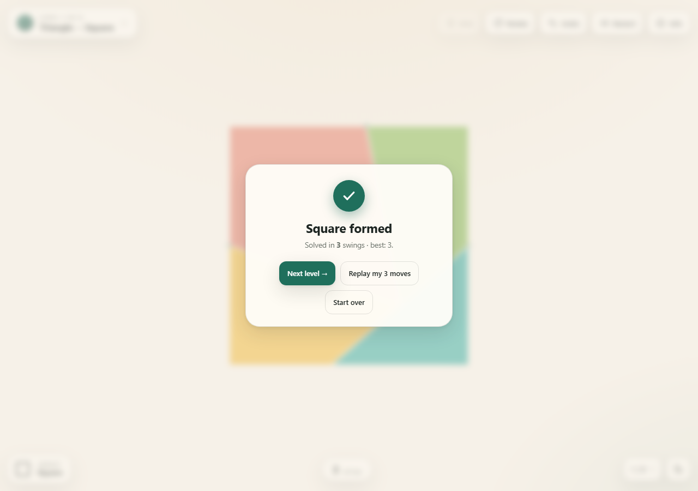
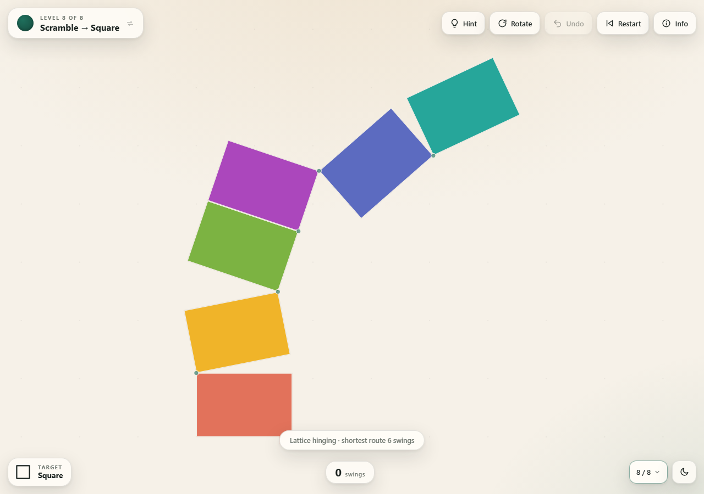

# Dissect

A small browser puzzle. You are handed a shape that has already been cut into
hinged pieces, and you have to swing them — one hinged group at a time — until
the outline becomes a different shape.

Seven level pairs (each one playable in both directions), plus a shuffled bonus
level:

1. **Triangle ⇄ Square** — the classic four-piece Dudeney dissection (3 swings each way)
2. **Triangle ⇄ Hexagon** — six pieces (5 swings each way)
3. **Square ⇄ Hexagon** — six pieces (5 swings each way)
4. **Triangle ⇄ Pentagon** — eight pieces (7 swings each way)
5. **Pentagon ⇄ Square** — seven pieces, the applet's pentagon-first setup (7 swings each way)
6. **Octagon ⇄ Square** — seven pieces (6 swings each way)
7. **Square ⇄ Triangle** — the eight-piece hexagram dissection's square/triangle pair (4 swings square → triangle, 7 swings triangle → square)
8. **Random scramble → Square** — six hinged rectangles dealt into a random start
   that is a verified 6–7 swings from the square. Four different hingings are in
   play; the card (or `S`) shuffles a new scramble, while Restart keeps the deal.

The level card in the top-left shows the direction you are currently playing
(`Triangle → Square`). **Click it to play the same dissection the other way** —
the title flips to `Square → Triangle` and the board reloads with the other
shape. The reverse is **not** the forward route played backwards: it re-hinges
the same pieces (a different spanning tree where the dissection allows one, or a
different root when it does not), so the hinge pins and the move sequence are
different. The forward direction always keeps its original hinging and steps.
The level button in the bottom-right lists every level.

Open `index.html` in any browser. It is a self-contained page (no build, no
dependencies, no network) and works offline.

## How to play

* **Tap / click a piece** to pick it up. Every legal swing appears as a dashed
  arc with a round handle showing the direction of travel.
* **Tap a handle** to swing in that direction. A piece travels as far as it can
  until it meets another piece (or 270°, whichever comes first).
* When a piece has **two** possible directions you get two handles, one on each
  side of the hinge — pick one.
* Pieces are physically hinged to their parent, so swinging a piece also carries
  everything behind it in the hinge tree. The whole moving group is outlined,
  and the block you pressed is always part of it.
* If a piece's own hinge is pinched, tapping it offers the larger hinged groups
  that carry it. The one piece with no hinge of its own is the board's anchor;
  tapping it turns the rest of the board about a hinge, so it can still move.
* The board is presented with the starting outline upright, the same way up as
  the target chip, and the finished outline is turned upright on the win.
* Nothing can pass through anything: every swing is collision-checked while it
  animates.
* The target silhouette is shown in the bottom-left chip. The counter in the
  middle tracks your swings.

Buttons: **Hint** (searches for the shortest remaining route and points out the
first move — it works from wherever you are, even after wandering off the
intended path), **Rotate** (turns the board 90° clockwise), **Undo**,
**Restart**, and **Info** (how to play, the credits, and the light/dark
toggle). Keyboard: `U` undo, `R` restart, `H` hint, `Q` rotate, `I` info,
`L` levels, `S` swap direction, `D` light/dark, `Esc` deselect / close / skip a
replay.

The game follows your system's colour scheme until you pick light or dark with
the toggle in the bottom-right corner; that choice is remembered.

When a level is finished the card lets you **replay your own solution** — the
exact sequence of swings you made, however many that was — or start the level
over. Click or tap outside the card, or press `Esc`, to dismiss it and just look
at the solved board.

The camera simply pulls back during a swing (no rotation) so the whole board
stays in view, then eases back to the normal framing.

## The random scramble

Level 8 is a square cut into six congruent 2:3 rectangles. The same pieces are
hinged four different ways, and each hinging carries a pool of scrambled starts
whose shortest route back to the square is six or seven swings. Entering the
level deals one of them at random; the level card (or `S`) shuffles a new deal,
and Restart keeps the one you are on. Every deal is re-solved by the game's own
search before it is served, so it is always possible in the advertised number of
swings.

Made by **[Malcolm Blakeman](https://github.com/malcolmblakeman)**.

Best scores are kept per direction in `localStorage` under
`hinge-puzzle-best-v1`.
